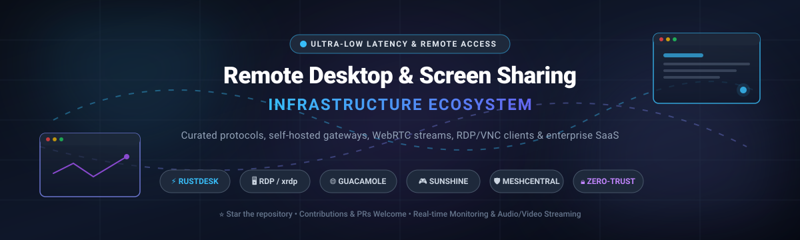

# Awesome Remote Desktop & Screen Sharing Infrastructure 🖥️⚡

  

  
  
  
  
  

---

## 📌 Executive Overview & Ecosystem Architecture

Welcome to the definitive, curated index of **Remote Desktop & Screen Sharing Infrastructure** 🌐. Whether delivering enterprise helpdesk support, configuring low-latency WebRTC/P2P remote workstation streaming, or orchestrating self-hosted clientless HTML5 gateways (RDP, VNC, SSH, SPICE), this repository highlights production-grade **SaaS platforms** and high-performance **open-source repositories**.

### 🔍 Key Capabilities Evaluated
- 🚀 **Low Latency & High FPS Streaming**: NVENC/VAAPI-accelerated H.264/HEVC/AV1 encoding (Sunshine, Moonlight, Parsec).
- 🛡️ **Zero-Trust & Privileged Remote Access**: Identity-aware access gateways, MFA enforcement, session auditing, and PAM workflows (BeyondTrust, Guacamole, ShellHub).
- 🌐 **Clientless Browser Gateways**: HTML5 WebSockets canvas streaming eliminating client installations (Apache Guacamole, noVNC, KasmVNC).
- 🏢 **Fleet & Unattended Endpoint Management**: Centralized mesh agent architectures with remote shell and telemetry (MeshCentral, RustDesk Server).

---

## 📑 Table of Contents
- [Sector Overview & Market Dynamics](#sector-overview--market-dynamics) 📊
- [SaaS & Commercial Remote Desktop Platforms](#saas--commercial-remote-desktop-platforms) 💼
- [Open-Source Remote Desktop & Streaming Infrastructure](#open-source-remote-desktop--streaming-infrastructure) 🔓
- [Core Architecture Stacks & Recommendations](#core-architecture-stacks--recommendations) 🛠️
- [How to Contribute](#how-to-contribute) 🤝
- [Support](#support) 💖
- [Star History](#star-history) 📈
- [Disclaimer](#disclaimer) ⚠️

---

## Sector Overview & Market Dynamics 📊

The global remote desktop software market is estimated at **$3.6 billion to $3.96 billion in 2024–2025** and is projected to expand past **$5.0 billion by 2026** (scaling at a Compound Annual Growth Rate of ~14% to 17% toward $15B+ by the early 2030s). 

The market dynamics exhibit **moderate fragmentation**: while legacy enterprise remote support and IT management have consolidated around multi-billion-dollar incumbents (TeamViewer, GoTo/LogMeIn, BeyondTrust, ConnectWise), rapid innovation across low-latency gaming protocols, edge streaming, and transparent open-source alternatives (RustDesk, Sunshine/Moonlight) prevents a winner-take-all monopoly and empowers self-hosting.

---

## SaaS & Commercial Remote Desktop Platforms 💼

The following commercial and managed platforms provide turnkey global relay infrastructure, NAT traversal, corporate compliance certifications, and managed client software. Sorted descending by company scale (valuation / annual revenue):

| Platform / Vendor | Company Scale (Valuation / Revenue) 🏢 | Pricing (Starting Tier) 💵 | Free Tier / Free Trial Limits 🎁 | Description & Target Workload 🎯 |
| :--- | :--- | :--- | :--- | :--- |
| **[Chrome Remote Desktop](https://remotedesktop.google.com/)** | **Alphabet: ~$2.1T+ Market Cap** ($300B+ Rev) | Free / Included ($0) | **100% Free Forever Plan**: Unlimited sessions and devices linked to Google account; lacks centralized IT audit console | Lightweight, browser-based remote access and temporary screen assistance powered by Google account infrastructure. |
| **[Zoho Assist](https://www.zoho.com/assist/)** | **Zoho Corp: ~$15B Valuation** (~$1.5B Revenue) | **$10.00/tech/month** (Standard plan, billed annually) | **Forever Free Plan**: 1 technician, 1 concurrent session, 5 unattended computers, clipboard sharing, no file transfer | Bootstrapped cloud remote support and unattended management platform with deep IT service management (ITSM) integrations. |
| **[GoTo / LogMeIn Pro](https://www.logmein.com/)** | **GoTo: ~$4.3B Acquisition Valuation** (~$1.2B Revenue) | **$30.00/month** (Individuals plan, billed annually) | **14-day Free Trial**: Full access to remote desktop streaming for up to 2 computers; no permanent free tier | Veteran enterprise remote workstation access software featuring cloud drive storage, multi-monitor display, and LastPass licensing. |
| **[BeyondTrust Remote Support](https://www.beyondtrust.com/)** | **BeyondTrust: ~$1.5B+ Valuation** (~$400M–$500M ARR) | **~$2,300.00/year** per concurrent technician (Enterprise quote) | **14-day Free Trial**: Full access to enterprise remote support and privileged session features upon sales verification | Privileged remote access and helpdesk support platform built for compliance auditing, session recording, and Zero-Trust networks. |
| **[TeamViewer](https://www.teamviewer.com/)** | **TeamViewer SE: ~$1.0B–$1.5B Market Cap** (~€747M Revenue) | **$24.90/month** (Remote Access single-user, billed annually) | **Personal Free Plan**: Free for non-commercial personal use only (1 concurrent session; automated commercial detection blocks) | Global remote connectivity powerhouse offering unattended device control, automated NAT bypass, and mobile-to-PC screen sharing. |
| **[ConnectWise ScreenConnect](https://www.connectwise.com/)** | **ConnectWise: ~$1.5B Valuation** (~$250M Revenue) | **$30.00/month** (ScreenConnect One, billed annually) | **14-day Free Trial**: Full feature access; permanent personal free license tier has been discontinued | Purpose-built remote support and remote access software designed for MSPs, helpdesks, and enterprise sysadmins. |
| **[Splashtop](https://www.splashtop.com/)** | **Splashtop: ~$1.0B Valuation** (~$100M ARR) | **$5.00/month** ($60/year billed annually for Solo Access) | **7-day Free Trial**: Unlimited access to up to 2 computers with zero credit card required; no permanent free tier | High-performance remote access engine optimized for 4K video rendering, remote work, IT helpdesks, and educational labs. |
| **[AnyDesk](https://anydesk.com/)** | **AnyDesk: ~$660M Valuation** (~$100M+ ARR) | **$14.90/month** (Solo plan, billed annually) | **Personal Free Plan**: Occasional private non-commercial use only (1 connection, basic screen sharing; lacks address book & audit) | Ultra-lightweight remote desktop utility powered by the proprietary DeskRT video codec for low-bandwidth connections. |
| **[Parsec](https://parsec.app/)** | **Unity / Parsec: ~$320M Acquisition** | **$8.33/user/month** (Parsec Warp, billed annually) | **Personal Free Plan**: Unlimited 60 FPS ultra-low latency desktop streaming for personal gaming/rigs (no 4:4:4 or multi-monitor) | Groundbreaking ultra-low-latency desktop capture platform engineered for 60 FPS remote gaming, video editing, and Wacom tablet streaming. |
| **[RustDesk Pro](https://rustdesk.com/pricing.html)** | **RustDesk: High-growth Open-Core** (~$5M–$15M ARR run-rate) | **$9.90/month** (Individual plan, billed annually) | **Self-Hosted OSS Server Free Forever**: Unlimited users/devices via self-hosted relay; Pro 14-day trial for web console & address book | Commercial edition of RustDesk providing self-hosted or managed web admin consoles, LDAP/SSO sync, address books, and relay clustering. |
| **[RealVNC Connect](https://www.realvnc.com/)** | **RealVNC: Independent Scale** (~$30M Revenue) | **$8.25/month** (Essentials plan, billed annually) | **Home / Lite Free Plan**: Strictly non-commercial personal use for up to 3 computers; 1 user session at a time | Original commercial VNC vendor delivering cloud and direct peer-to-peer remote access with end-to-end 256-bit AES encryption. |

---

## Open-Source Remote Desktop & Streaming Infrastructure 🔓

Explore top open-source repositories powering self-hosted remote desktops, high-frame-rate game/desktop streaming, protocol servers, and browser-native gateways. 

Sorted descending by GitHub stargazer count:

| Repository / Project | Stars ⭐ | Primary Protocol & Role | Description & Architectural Highlights 💡 |
| :--- | :--- | :--- | :--- |
| **[RustDesk](https://github.com/rustdesk/rustdesk)** |  | P2P / WebRTC / RDP alternative | Full open-source remote desktop alternative to TeamViewer; written in Rust with cross-platform clients (Windows, Linux, macOS, Android, iOS) and self-hosted ID/relay servers. |
| **[Sunshine](https://github.com/LizardByte/Sunshine)** |  | NVHTTP / RTSP GameStream | Self-hosted, low-latency game and desktop streaming server; acts as an open-source replacement for NVIDIA GameStream with hardware-accelerated NVENC, AMD AMF, and Intel QuickSync. |
| **[Deskflow](https://github.com/deskflow/deskflow)** |  | KVM / Mouse-Keyboard Sharing | Open-source virtual KVM switch software allowing seamless mouse, keyboard, and clipboard sharing between multiple physical computers and operating systems on a local network. |
| **[Barrier](https://github.com/debauchee/barrier)** |  | Virtual KVM Protocol | Foundational open-source keyboard and mouse sharing software forked from Synergy; enables multi-monitor workflow across physical machines with TLS encryption. |
| **[Moonlight](https://github.com/moonlight-stream/moonlight-qt)** |  | NVIDIA GameStream / Sunshine Client | Ultra-low latency remote desktop and gaming client for Sunshine and NVIDIA GameStream, streaming 4K HDR at 120+ FPS across desktop, mobile, and embedded platforms. |
| **[noVNC](https://github.com/novnc/noVNC)** |  | HTML5 WebSockets VNC | Pure JavaScript/HTML5 VNC client library using WebSockets and Canvas rendering; allows zero-install browser access to any standard RFB/VNC server. |
| **[FreeRDP](https://github.com/FreeRDP/FreeRDP)** |  | RDP (Remote Desktop Protocol) | Industry-standard open-source C implementation of Microsoft Remote Desktop Protocol (RDP); powers thousands of commercial thin clients, gateways, and Linux tools. |
| **[RustDesk Server](https://github.com/rustdesk/rustdesk-server)** |  | Rendezvous & Relay Server | Open-source backend coordination server (hbbs/hbbr) for RustDesk; handles NAT punch-through, dynamic peer discovery, and encrypted relay tunneling for self-hosted instances. |
| **[Input Leap](https://github.com/input-leap/input-leap)** |  | KVM / Screen Sharing | Actively maintained open-source virtual KVM software enabling seamless cursor transition and clipboard transfer across diverse OS desktops. |
| **[MeshCentral](https://github.com/Ylianst/MeshCentral)** |  | Web Remote Management Suite | Comprehensive self-hosted web-based computer management server; deploys lightweight background agents for remote desktop, terminal shell, file management, and Intel AMT KVM. |
| **[TigerVNC](https://github.com/TigerVNC/tigervnc)** |  | VNC / RFB Protocol | High-speed, production-grade VNC implementation with server and viewer binaries; focuses on performance, 3D application streaming, and TLS encryption. |
| **[xrdp](https://github.com/neutrinolabs/xrdp)** |  | Open-Source RDP Server | Open-source Remote Desktop Protocol server for Linux; bridges standard Microsoft RDP clients (Windows Remote Desktop Connection) to X11/Wayland desktop environments. |
| **[KasmVNC](https://github.com/kasmtech/KasmVNC)** |  | Modern Web-Native VNC | Web-native remote desktop and VNC server rendering directly via HTML5 WebSockets, WebAssembly, and JPEG-Turbo/H.264 video compression; powers Kasm Workspaces. |
| **[Remotely](https://github.com/immense/Remotely)** |  | .NET Remote Support Suite | Modern open-source remote control and support tool built on C# and .NET; provides web console management, live screen sharing, audio, and unattended access agents. |
| **[Apache Guacamole Server](https://github.com/apache/guacamole-server)** |  | Clientless Gateway (RDP/VNC/SSH) | Enterprise clientless remote desktop gateway daemon (`guacd`); translates native RDP, VNC, and SSH protocols into Guacamole protocol for web browser rendering with zero plugins. |
| **[Xpra](https://github.com/Xpra-org/xpra)** |  | Persistent X11 Session Proxy | “Screen for X11”; allows users to view and interact with remote graphical applications and full desktop environments with persistent, detachable network sessions. |
| **[Remmina](https://github.com/FreeRDP/Remmina)** |  | Multi-Protocol Client | Leading GTK-based remote desktop client for POSIX systems; provides unified tabbed connections for RDP, VNC, SSH, SPICE, and X2Go protocols. |
| **[ShellHub](https://github.com/shellhub-io/shellhub)** |  | SSH Gateway behind NAT | Modern open-source gateway for remote device administration behind firewalls and NAT networks; offers web shell access, audit logging, and container support. |
| **[TurboVNC](https://github.com/TurboVNC/turbovnc)** |  | High-Speed 3D VNC | Optimized branch of VNC engineered specifically for high-frame-rate 3D graphics rendering, video playback, and image analysis workstations. |

---

## 🛠️ Core Architecture Stacks & Recommendations

Depending on your security boundaries, network constraints, and latency targets, recommended infrastructure patterns include:

- 🎮 **Ultra-Low-Latency Creative & Gaming Streaming**: Deploy **Sunshine** on GPU hosts paired with **Moonlight** clients for hardware-accelerated 60–120 FPS capture.
- 🛡️ **Zero-Footprint Enterprise Bastion**: Run **Apache Guacamole** behind an Nginx reverse proxy with OIDC/SAML single sign-on; connect to internal targets via native RDP/SSH without opening edge ports.
- 🏢 **Fleet IT Management & Helpdesk Support**: Use **MeshCentral** or a private **RustDesk Server** (`hbbs`/`hbbr`) cluster for always-on unattended background agents and encrypted remote sessions.
- 🐧 **Linux Terminal Server Multi-User Access**: Combine **xrdp** + **FreeRDP** or **X2Go** for lightweight Linux workstation virtual desktop infrastructure (VDI).

---

## 🤝 How to Contribute

We welcome additions, corrections, and new infrastructure projects! 🚀

1. Fork this repository 🍴
2. Add your project or update existing metadata in `README.md` (keep descriptions objective and verify star counts/licensing)
3. Ensure the project matches the scope of remote desktop, screen sharing, or low-latency graphical streaming
4. Submit a Pull Request with a clear description 📬

⭐ **Star the repo if you find it helpful!**

---

## 💖 Support

If you find this curated collection of remote desktop and screen sharing infrastructure useful, thank you for supporting the project! 🌟

Here is how you can help keep it thriving:
- ⭐ **Star this repository** to help others discover it on GitHub.
- 🍴 **Fork and contribute** new tools, benchmarks, and updates.
- 📢 **Share with colleagues**, IT support teams, DevOps engineers, and community forums.
- ☕ **Buy me a coffee / Sponsor**: If this index saved you research hours or infrastructure costs, consider sponsoring via the [GitHub Sponsors Dashboard](https://github.com/sponsors/ishandutta2007):

  

---

##  Star History

  

  

---

## ⚠️ Disclaimer

- This repository is a community-maintained curated index and does not represent an endorsement of any commercial platform or third-party open-source code.
- Remote access utilities and screen sharing infrastructure possess privileged system capabilities. Always configure end-to-end encryption, multi-factor authentication (MFA), IP whitelisting, and strict least-privilege access rules before deploying to production networks.
